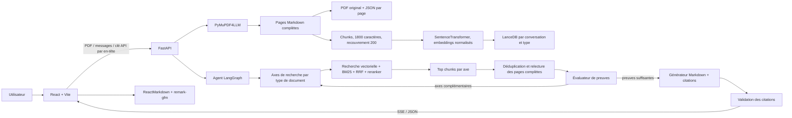
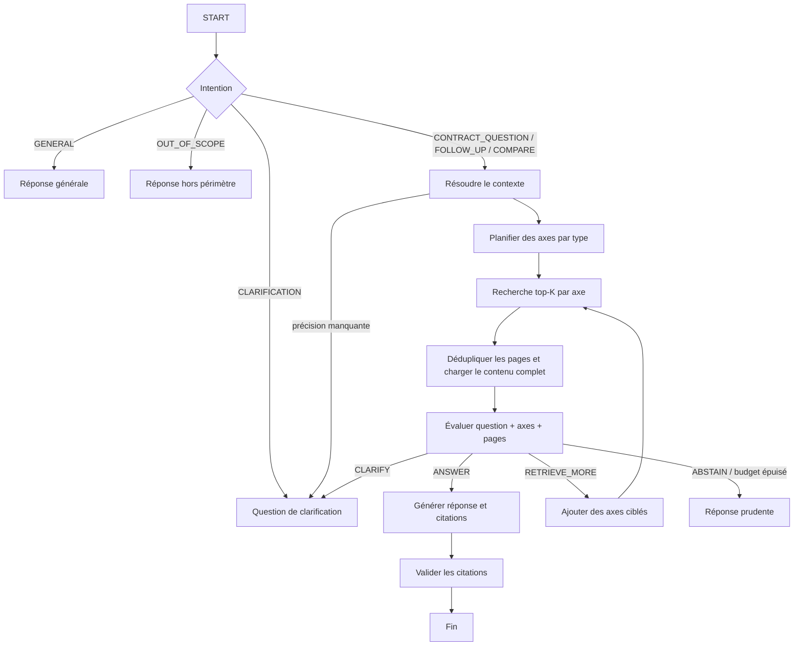

# Assistant IA pour l'assurance habitation

> Un assistant conversationnel qui analyse les documents d'assurance habitation importés par l'utilisateur et répond à partir des clauses retrouvées, avec des sources consultables.

Ce README décrit le fonctionnement actuel du dépôt, de l'import du PDF au rendu de la réponse. Il distingue les pages originales, les chunks utilisés pour la recherche et les pages complètes utilisées par l'évaluateur : ces trois niveaux ont des rôles différents.

## Sommaire

- [Vue d'ensemble](#vue-densemble)
- [Technologies](#technologies)
- [Démarrage local](#démarrage-local)
- [Configuration](#configuration)
- [Backend](#backend)
	- [Ingestion d'un document](#ingestion-dun-document)
	- [Stockage et modèle de données](#stockage-et-modèle-de-données)
	- [Embeddings et index](#embeddings-et-index)
	- [Algorithme de recherche](#algorithme-de-recherche)
	- [Agent conversationnel](#agent-conversationnel)
	- [Évaluation, génération et citations](#évaluation-génération-et-citations)
	- [API HTTP et flux SSE](#api-http-et-flux-sse)
- [Frontend](#frontend)
	- [Architecture React](#architecture-react)
	- [État et persistance](#état-et-persistance)
	- [Import, conversation et sources](#import-conversation-et-sources)
	- [Rendu Markdown](#rendu-markdown)
- [Tests et validation](#tests-et-validation)
- [Limites et décisions importantes](#limites-et-décisions-importantes)
- [Structure du dépôt](#structure-du-dépôt)

## Vue d'ensemble

Le navigateur gère l'interface et l'état de travail de l'utilisateur. FastAPI reçoit les PDF et les messages, orchestre l'agent et conserve les données sur disque. LanceDB fournit l'index vectoriel local des chunks. Le fournisseur de LLM est appelé avec la clé que l'utilisateur a saisie dans l'interface.



Le LLM ne parcourt pas directement le PDF. Le PDF est converti en Markdown page par page, indexé sous forme de chunks, puis les pages liées aux résultats retenus sont relues pour l'évaluation.

## Technologies

| Partie | Technologies principales |
|---|---|
| API | Python, FastAPI, Pydantic |
| Orchestration agent | LangGraph |
| Extraction PDF | PyMuPDF, PyMuPDF4LLM |
| Découpage et embeddings | Python, SentenceTransformers, NumPy |
| Index vectoriel | LanceDB local |
| Recherche lexicale | `rank-bm25` |
| Reranking | Cross-encoder SentenceTransformers |
| Fournisseurs LLM | OpenAI, Anthropic, Google Gemini via LangChain |
| Interface | React 19, TypeScript, Vite, Zustand |
| Markdown côté navigateur | `react-markdown`, `remark-gfm` |


## Démarrage local

### Prérequis

- Python compatible avec les dépendances backend (l'environnement de développement courant utilise Python 3.12).
- Node.js et npm.
- Accès réseau au premier lancement pour télécharger les modèles d'embedding et de reranking, sauf s'ils sont déjà présents dans le cache local.
- Une clé API valide pour l'un des fournisseurs LLM, saisie dans **Réglages LLM** de l'application.

### Backend

Depuis la racine du dépôt, sous PowerShell :

```powershell
cd backend
python -m venv .venv
.\.venv\Scripts\Activate.ps1
pip install -r requirements.txt
uvicorn app.main:app --reload --host 0.0.0.0 --port 8000
```

Sous macOS/Linux, l'activation de l'environnement virtuel est généralement :

```bash
source .venv/bin/activate
```

FastAPI est disponible sur `http://localhost:8000`. La route `GET /health` vérifie que l'API répond.

### Frontend

Dans un second terminal :

```powershell
cd frontend
npm install
npm run dev
```

Vite démarre normalement sur `http://localhost:5173`. Le proxy Vite transmet `/api/...` à `http://localhost:8000/...` et retire le préfixe `/api`.

Commandes frontend disponibles :

```bash
npm run dev       # serveur de développement
npm run typecheck # vérification TypeScript
npm run build     # typecheck et build de production
npm run preview   # prévisualisation du build
```

## Configuration

### Variables backend

Les variables sont lues par `python-dotenv` et peuvent être définies dans l'environnement ou dans un fichier `.env` local au backend.

| Variable | Défaut | Rôle |
|---|---|---|
| `STORAGE_PATH` | `./storage` | Racine des conversations, PDF, JSON et index LanceDB. Le chemin est résolu depuis le répertoire courant du processus. |
| `MAX_UPLOAD_SIZE_MB` | `30` | Taille maximale d'un upload PDF. |
| `CORS_ORIGINS` | `http://localhost:5173,http://localhost:3000` | Origines navigateur autorisées par CORS. |
| `EMBEDDING_MODEL` | `BAAI/bge-m3` | Modèle SentenceTransformer utilisé pour les chunks et les requêtes. |
| `EMBEDDING_DIMENSION` | `1024` | Dimension attendue des vecteurs de `BAAI/bge-m3`. Elle doit correspondre au modèle. |
| `RERANKER_MODEL` | `BAAI/bge-reranker-v2-m3` | Cross-encoder de reranking. |
| `AGENT_TRACE` | `off` | Contrôle les traces : `off`, `summary` ou `full`. |

Changer de modèle ou de dimension d'embedding rend les vecteurs existants incompatibles : il faut réindexer les documents concernés. Le premier chargement des modèles peut nécessiter un téléchargement important.


### Fournisseur LLM et clé API

Dans **Réglages LLM**, l'utilisateur choisit un fournisseur, un identifiant de modèle et sa clé API. Les fournisseurs backend sont `openai`, `anthropic` et `gemini` ; le frontend nomme son choix Google `google` puis le convertit en `gemini` dans l'en-tête HTTP.

La clé :

- reste en mémoire JavaScript dans l'onglet ;
- n'est pas enregistrée dans `localStorage`, `sessionStorage` ni dans la conversation backend ;
- est envoyée au backend dans `X-LLM-Api-Key` pour les messages ;
- doit être ressaisie après un rechargement complet de la page.


## Backend

### Ingestion d'un document

L'import est déclenché par `POST /conversations/{conversation_id}/documents` avec un PDF multipart et son type (`CG`, `CP`, `AVENANT` ou `ANNEXE`). Le traitement est synchrone et suit ces étapes :

1. **Validation de l'upload** : le nom doit se terminer par `.pdf`, le fichier doit respecter `MAX_UPLOAD_SIZE_MB`, le PDF ne doit pas être chiffré, vide ni dépasser 500 pages.
2. **Identité et isolation** : le backend génère un UUID de document et écrit le document dans le dossier de sa conversation et de son type.
3. **Conservation de l'original** : le PDF est écrit sur disque.
4. **Extraction page par page** : `pymupdf4llm.to_markdown(..., page_chunks=True, header=False, footer=False)` produit un texte Markdown pour chaque page.
5. **Nettoyage conservateur** : suppression des caractères NUL, réduction des séries de lignes vides, normalisation de quelques espaces autour des apostrophes et signes de ponctuation. Le contenu contractuel n'est pas filtré intentionnellement.
6. **Métadonnées de page** : chaque page conserve les identifiants de conversation/document, le nom et le type de document, son numéro, ses titres extraits et son Markdown complet.
7. **JSON de référence** : les pages sont enregistrées dans un fichier JSON UTF-8. Ce JSON sert à recharger le contenu complet et à afficher une page source.
8. **Chunking** : le Markdown est découpé en morceaux adaptés à l'indexation.
9. **Embeddings** : un vecteur est calculé pour chaque chunk.
10. **Indexation** : les chunks et vecteurs sont enregistrés dans LanceDB.
11. **Vérification** : le backend compare le nombre de chunks créés et écrits. En cas d'échec, il supprime les artefacts PDF/JSON et les vecteurs du document pour éviter un index orphelin.

Le type CG/CP/etc. est une métadonnée métier donnée à l'import ; il détermine notamment quel sous-index est consulté par la recherche.

### Stockage et modèle de données

Par défaut, le stockage est local sous `backend/storage` lorsque l'API est lancée depuis le dossier `backend` :

```text
storage/
└── conversations/<conversation_id>/
		├── conversation.json
		├── history.jsonl
		├── pending_clarification.json       # seulement lorsqu'une précision attend une réponse
		├── agent_trace.jsonl                # selon AGENT_TRACE
		├── documents/
		│   ├── cg/<document_id>.pdf
		│   ├── cg/<document_id>.json        # pages complètes en Markdown
		│   ├── cp/<document_id>.pdf
		│   └── ...
		└── lancedb/
				├── cg/chunks/                   # index LanceDB pour CG
				├── cp/chunks/                   # index LanceDB pour CP
				└── ...
```

Les répertoires `cg`, `cp`, `avenant` et `annexe` sont séparés. L'index LanceDB contient les chunks, leurs métadonnées et leurs vecteurs ; le JSON contient les pages complètes. Une conversation est identifiée par un UUID et isolée des autres conversations.

`history.jsonl` contient des messages utilisateur/assistant, les réponses, citations et limitations. La suppression d'une conversation supprime son répertoire complet, donc aussi ses PDF, JSON, historique et index.

### Découpage en chunks

Le découpage est réalisé par `chunk_document_pages` après l'extraction des pages :

- taille cible maximale : **1 800 caractères** ;
- recouvrement entre chunks : **200 caractères** ;
- les limites de paragraphes et de phrases sont privilégiées ;
- un paragraphe trop long est séparé sur les phrases ; une phrase exceptionnellement trop longue est découpée par fenêtres de caractères ;
- le recouvrement conserve un peu de contexte entre deux unités voisines ;
- l'index du chunk repart de zéro pour chaque page.

Un identifiant de chunk est construit sous la forme :

```text
<document_id>:<page_number>:<chunk_index>
```

Chaque chunk conserve le lien vers sa page, son document, son type, son chapitre et ses titres. Le texte du chunk n'est pas remplacé par le texte d'embedding.

### Embeddings et index

Le service d'embedding est une instance partagée et charge le modèle paresseusement. Par défaut, le modèle est `BAAI/bge-m3` avec une dimension de 1 024. Les embeddings sont calculés par lots de 16 et normalisés.

Pour donner du contexte au vecteur, `build_embedding_text` compose :

```text
Type de document : CP
Chapitre : Garanties
Titres de la page : ...
Texte : <texte original du chunk>
```

Le texte original du chunk reste stocké séparément. Si un modèle E5 est configuré, le service ajoute automatiquement les préfixes `query:` et `passage:` appropriés. Les dimensions et les valeurs non finies sont contrôlées avant l'écriture.

Chaque table LanceDB est locale à une conversation et à un type de document. La table stocke l'identifiant de chunk, les métadonnées, le texte du chunk, le texte vectorisé et le vecteur.

### Algorithme de recherche

Le planner produit une liste d'axes indépendants. Chaque axe contient :

- `axis_id` : identifiant de l'axe dans le plan ;
- `document_type` : un seul type parmi CG, CP, AVENANT et ANNEXE ;
- `query` : requête autonome adaptée à ce type ;
- `reason` : raison de cette recherche.

Exemple conceptuel : une question sur le contenu d'une garantie peut produire un axe CG pour les conditions/exclusions générales et un axe CP pour l'option, le plafond ou la franchise propre au contrat.

Pour **chaque axe**, le retriever appelle `HybridRetriever.search` avec un seul type de document et le `TOP_K` configuré (6). L'algorithme de cette recherche est le suivant :

1. **Embedding de requête** : le même modèle que pour les chunks vectorise la requête.
2. **Recherche vectorielle** : LanceDB récupère jusqu'à 20 chunks proches par similarité vectorielle pour le type visé.
3. **Recherche BM25** : les chunks du type sont tokenisés en minuscules, les accents sont normalisés et les tokens d'un seul caractère sont ignorés. BM25 classe lexicalement le corpus et conserve jusqu'à 20 résultats avec score positif.
4. **Fusion RRF** : les deux listes sont combinées par Reciprocal Rank Fusion. Pour un rang `r`, le score ajouté est `1 / (60 + r + 1)`. Un chunk bien classé par les deux méthodes remonte dans le classement fusionné.
5. **Pool de candidats** : les meilleurs chunks fusionnés sont limités à 30 avant reranking.
6. **Cross-encoder** : `BAAI/bge-reranker-v2-m3` rescrore chaque couple requête/texte candidat, en ajoutant le type et les titres au texte présenté au modèle. Les candidats sont triés par ce score.
7. **Top-K de l'axe** : les six premiers chunks rerankés sont retournés pour cet axe.

Les tokens sont simples et transparents : normalisation Unicode NFKD, suppression des diacritiques, regex `\w+`. Le score BM25 et le score vectoriel sont fusionnés par rang, et non par comparaison directe de leurs échelles.

Après chaque axe, les résultats sont dédupliqués par `chunk_id`. Si un chunk est retenu par plusieurs axes, sa provenance par axe est conservée. Les résultats des nouvelles tentatives sont cumulés avec les résultats antérieurs.


### Agent conversationnel

L'agent est un graphe LangGraph construit dans `build_agent_graph`. Tous les nœuds lisent et mettent à jour un état partagé (`AgentState`) contenant les questions, documents disponibles, axes, résultats, pages, décision, citations et réponse.



#### Nœuds du graphe

1. **Routeur (`router`)** : classe le message en `GENERAL`, `CONTRACT_QUESTION`, `FOLLOW_UP`, `COMPARE`, `CLARIFICATION` ou `OUT_OF_SCOPE`. Il peut forcer le parcours documentaire pour une demande explicite sur un fichier importé et demander lequel si plusieurs fichiers rendent la demande ambiguë.
2. **Résolution du contexte (`resolve_context`)** : utilise l'historique pour rendre une question de suivi autonome, sans inventer des informations contractuelles. Peut demander une précision si le contexte ne suffit pas.
3. **Planification (`plan_retrieval`)** : limite les types aux documents effectivement indexés et demande au LLM des axes distincts par type. Si aucun axe valide n'est retourné, une stratégie de secours utilise la question dans chaque type disponible.
4. **Recherche (`retrieve`)** : exécute une recherche séparée pour chaque axe avec son type documentaire et son top-K.
5. **Assemblage des preuves (`build_evidence`)** : déduplique les pages par document/type/numéro, lit les JSON d'origine pour récupérer le contenu complet et associe chaque page aux axes et chunks qui l'ont retrouvée.
6. **Évaluation (`evaluate`)** : reçoit en une fois la question originale, la question contextualisée, les axes, l'historique des requêtes, les documents disponibles et les pages complètes. Elle rend une évaluation par axe et choisit `ANSWER`, `RETRIEVE_MORE`, `CLARIFY` ou `ABSTAIN`.
7. **Raffinement (`refine_retrieval`)** : si l'évaluateur fournit des requêtes de suivi, le planner de raffinement propose des axes additionnels. Les axes et preuves précédents sont conservés.
8. **Génération (`answer`)** : ne s'exécute que si l'évaluateur donne `ANSWER` et des pages d'appui valides. Elle reçoit les pages d'appui, les constats par axe, les limitations et les contradictions.
9. **Validation (`validate_citations`)** : vérifie que chaque citation produite correspond à un chunk réellement présent dans les preuves et que ses métadonnées sont exactes.

La limite est de trois passages dans le retriever au total (recherche initiale et au plus deux recherches complémentaires). L'évaluateur a également un garde-fou contre les requêtes déjà exécutées et un maximum de deux itérations complémentaires.

### Évaluation, génération et citations

L'évaluateur analyse les pages entières et distingue notamment : information couverte, partielle, absente ou contradictoire. Il ne répond pas à l'utilisateur. Son schéma impose entre autres une page d'appui pour `ANSWER`, une requête de suivi pour `RETRIEVE_MORE` et une question non vide pour `CLARIFY`.

Avant la génération, les pages d'appui du modèle sont validées contre les pages effectivement récupérées. Si une réponse `ANSWER` ne pointe vers aucune page valide, elle est déclassée en abstention. Le générateur reçoit les seules pages d'appui retenues, les analyses par axe, les limitations et les contradictions.

La réponse est une chaîne Markdown GFM. Chaque fait contractuel doit comporter un marqueur interne `[[cite:<chunk_id>]]`. Le générateur fournit en parallèle une liste structurée de citations. Le validateur :

- retrouve le chunk cité parmi les preuves récupérées ;
- compare l'identifiant de document, le nom, le type et la page avec les métadonnées réelles ;
- attache le texte du chunk comme extrait vérifié ;
- élimine les répétitions de chunks et les citations multiples vers la même page.

Le backend renvoie le Markdown sans conversion HTML. Le frontend transforme le marqueur en bouton de source et affiche la page complète au clic.

### API HTTP et flux SSE

FastAPI expose les routes principales suivantes :

| Route | Fonction |
|---|---|
| `GET /health` | Vérifie que le backend répond. |
| `POST /conversations` | Crée une conversation UUID et son dossier. |
| `POST /conversations/{id}/documents` | Valide, extrait, découpe, vectorise et indexe un PDF. |
| `GET /conversations/{id}/documents` | Liste les documents ingérés dans cette conversation. |
| `GET /conversations/{id}/documents/{document_id}/pages/{page_number}` | Renvoie le Markdown complet d'une page source. |
| `POST /conversations/{id}/messages` | Exécute une question et retourne une réponse JSON non-streamée. |
| `POST /conversations/{id}/messages/stream` | Même traitement avec progression Server-Sent Events. |
| `GET /conversations/{id}/messages` | Recharge l'historique JSONL. |
| `DELETE /conversations/{id}` | Supprime tous les fichiers et index de la conversation. |

Les messages acceptent jusqu'à 8 000 caractères. Les routes de message exigent les en-têtes `X-LLM-Provider`, `X-LLM-Model` et `X-LLM-Api-Key`.

La route SSE exécute le traitement dans un thread, transmet des événements `step` à mesure que les nœuds démarrent/finissent, puis un événement `answer`, `error` ou `done`. Des keep-alives maintiennent le flux ouvert. Les détails de progression sont des résumés ; le raisonnement interne du modèle n'est pas envoyé.

Les appels du modèle sont construits par requête et chaque fournisseur dispose de son adaptateur LangChain : `ChatOpenAI`, `ChatAnthropic` ou `ChatGoogleGenerativeAI`. Les sorties de planification, de routage et d'évaluation utilisent des schémas Pydantic structurés.

## Frontend

### Architecture React

`App.tsx` compose l'écran avec :

- `Sidebar` : sélection et suppression de conversation, ouverture des réglages ;
- `ChatHeader` : titre, accès à l'import et état des documents ;
- `MessageList` / `AgentResponse` : messages, étapes, réponse et sources ;
- `Composer` : saisie et envoi de question ;
- `UploadDialog` : sélection de PDF, type documentaire par fichier, file d'attente et indexation ;
- `SettingsDialog` : fournisseur, modèle, clé ;
- `SourceDrawer` : page complète de la citation sélectionnée.

La logique de données est en dehors des composants React : `api/client.ts` encapsule HTTP/SSE ; `state/controller.ts` orchestre les opérations ; `state/store.ts` héberge l'état Zustand. Les contrats TypeScript sont définis dans `types.ts`.

### État et persistance

| Données | Stockage navigateur | Durée / comportement |
|---|---|---|
| Conversations et messages locaux | `sessionStorage` via Zustand | Survivent au rechargement de l'onglet. L'application conserve le `backendId` lorsqu'il existe. |
| Fournisseur et modèle LLM | `localStorage` | Mémorisés sur cet appareil. |
| Clé API | Mémoire Zustand uniquement | Jamais persistée ; à ressaisir après fermeture/rechargement complet. |
| État de dialogue et panneau source | Mémoire Zustand | Purement visuel et temporaire. |
| PDF, JSON, index et historique faisant autorité | Disque backend | Liés à l'UUID de conversation. |

Au montage, l'application recharge depuis FastAPI les documents et l'historique des conversations locales qui possèdent déjà un UUID backend. Il n'existe pas de route qui liste toutes les conversations backend : la restauration dépend donc du `backendId` conservé dans le `sessionStorage` de l'onglet.

Si un rechargement interrompt une réponse ou un upload, le front marque le traitement comme interrompu au lieu de prétendre qu'il a continué en arrière-plan.

### Import, conversation et sources

Le dialogue d'import accepte plusieurs PDF et permet d'attribuer un type à chacun. Le frontend valide le type, la taille et le fichier vide ; il transmet ensuite les fichiers **séquentiellement** au backend. L'indexation elle-même est synchrone par PDF : il n'y a pas de progression interne page par page, seulement le nom du fichier et l'étape générale.

La première demande ou le premier upload crée la conversation backend si nécessaire. Pour l'envoi d'un message, le contrôleur :

1. ajoute le message utilisateur et une réponse agent « en cours » dans Zustand ;
2. récupère ou crée l'UUID de conversation backend ;
3. ouvre le flux SSE avec le texte, le fournisseur, le modèle et la clé ;
4. met à jour les étapes au fil des événements ;
5. stocke la réponse Markdown, les citations et les limitations dans le message local.

Les citations sont converties en objets frontend contenant notamment document, type, numéro de page, chunk et extrait vérifié. Le clic sur un bouton de citation ouvre le panneau source, qui charge le Markdown complet de la page par l'API.

### Rendu Markdown

`MarkdownContent.tsx` utilise `react-markdown` avec `remark-gfm` pour interpréter le Markdown des réponses et des pages source. Cela prend en charge les titres, listes, liens, emphases et tableaux GFM. Les tableaux larges sont placés dans un conteneur horizontalement défilable.

Le HTML brut n'est pas activé : le backend transmet une chaîne Markdown, et React crée les éléments sans injecter de HTML fourni par le document. Les marqueurs `[[cite:<chunk_id>]]` sont convertis côté frontend en liens internes ; un composant React les remplace par des boutons numérotés qui ouvrent la source. Une compatibilité de rendu existe aussi pour les anciennes références textuelles comportant `chunk_id`.

## Tests et validation

Depuis le dossier `backend`, avec l'environnement Python du projet activé :

```powershell
python -m unittest discover -s tests -p "test_*.py"
python -m compileall -q app
```

Les tests couvrent notamment le plan à axes multiples, le top-K par axe, la fusion des chunks dupliqués, la conservation des axes lors du raffinement, le dédoublonnage/rechargement des pages et les garde-fous de l'évaluateur.

Depuis `frontend` :

```bash
npm run typecheck
npm run build
```

## Limites et décisions importantes

- **Qualité des tableaux PDF** : PyMuPDF4LLM peut produire des cellules Markdown imparfaites, notamment si un mot est coupé ou si un retour de ligne est mal interprété. Le nettoyage est volontairement conservateur : une suppression globale des `<br>` risquerait de fusionner du contenu.

- **Recherche complémentaire** : le système est borné à trois recherches au total afin d'éviter une boucle infinie.
- **Index local** : les index LanceDB sont stockés sur disque.
- **Première exécution** : SentenceTransformers peut télécharger le modèle d'embedding et le cross-encoder, ce qui requiert du réseau et de l'espace disque.
- **Traces sensibles** : `AGENT_TRACE=full` peut enregistrer des prompts et pages de contrats. Garder `AGENT_TRACE=off` en production, ou contrôler strictement l'accès et la rétention des traces.
- **Clé API** : elle est transmise au backend et au fournisseur pendant le traitement. Ne pas la journaliser, l'inclure dans un fichier versionné ou la coller dans un ticket/chat.
- **Concurrence** : les verrous de conversation sont locaux au processus FastAPI. Un déploiement multi-processus ou multi-instance nécessiterait un mécanisme de verrou partagé.

## Structure du dépôt

```text
backend/
├── app/
│   ├── main.py                         # conversations, upload, pages, suppression
│   ├── agent_router.py                 # API chat, SSE, historique et traces
│   └── services/
│       ├── data_base_service/
│       │   ├── document_ingestion.py   # PDF vers pages Markdown
│       │   ├── chunking.py             # validation et découpage en chunks
│       │   ├── embeddings.py           # SentenceTransformer
│       │   └── vector_store.py          # LanceDB et chargement des pages
│       └── ai_agent_service/
│           ├── graph.py                # graphe LangGraph
│           ├── router.py               # classification de la demande
│           ├── context_resolver.py     # résolution des suivis
│           ├── retrieval_planner.py    # axes de recherche
│           ├── agent_retrieval.py      # recherche par axe
│           ├── retrieval_algorithm.py  # vectoriel, BM25, RRF, reranker
│           ├── evidence_builder.py     # déduplication et pages complètes
│           ├── evidence_evaluator.py   # couverture, décisions, relances
│           ├── answer_generator.py     # réponse Markdown et citations
│           └── citation_validator.py   # validation des références
└── tests/                              # tests unitaires backend

frontend/
├── src/
│   ├── api/client.ts                   # client FastAPI et lecteur SSE
│   ├── state/store.ts                  # état Zustand et persistance
│   ├── state/controller.ts             # orchestration conversation/upload
│   ├── components/                     # interface et dialogues
│   ├── components/MarkdownContent.tsx  # renderer GFM et liens de citation
│   ├── lib/                            # fournisseurs et utilitaires
│   └── types.ts                        # modèles TypeScript
└── package.json
```
